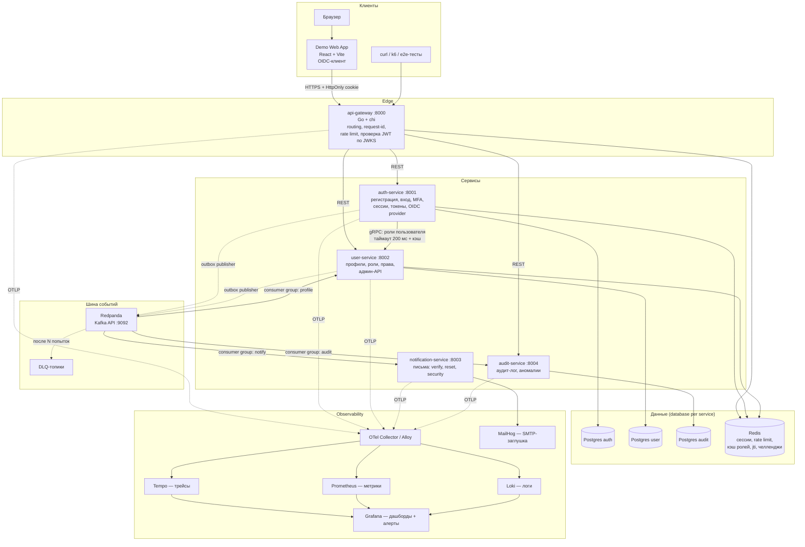
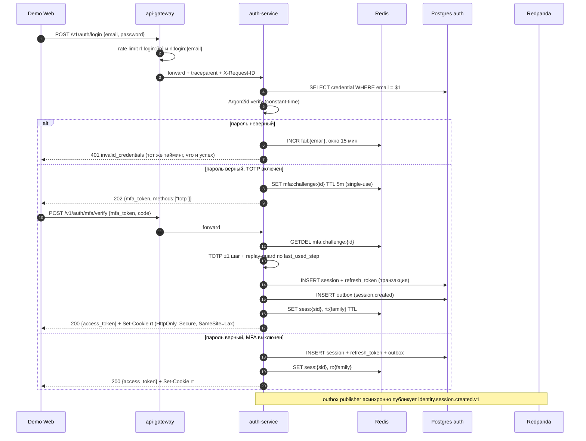
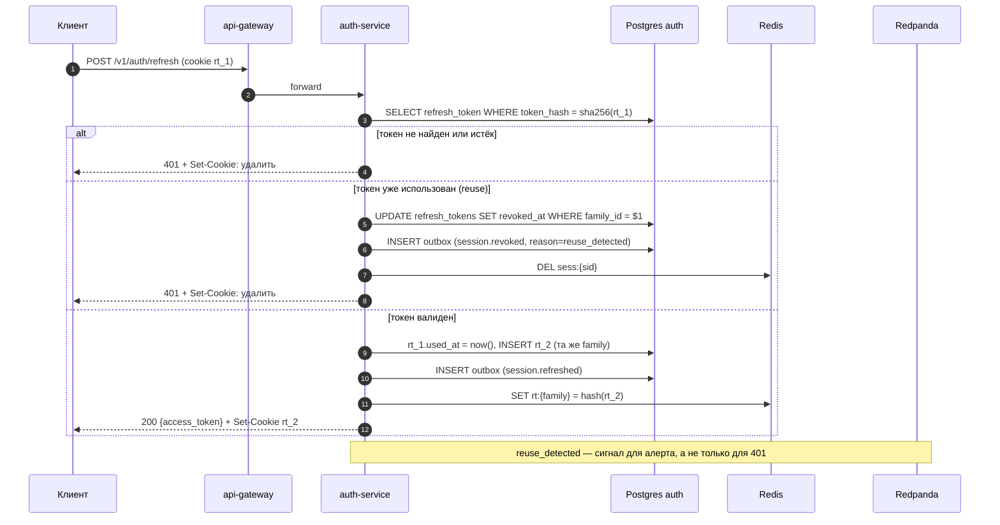
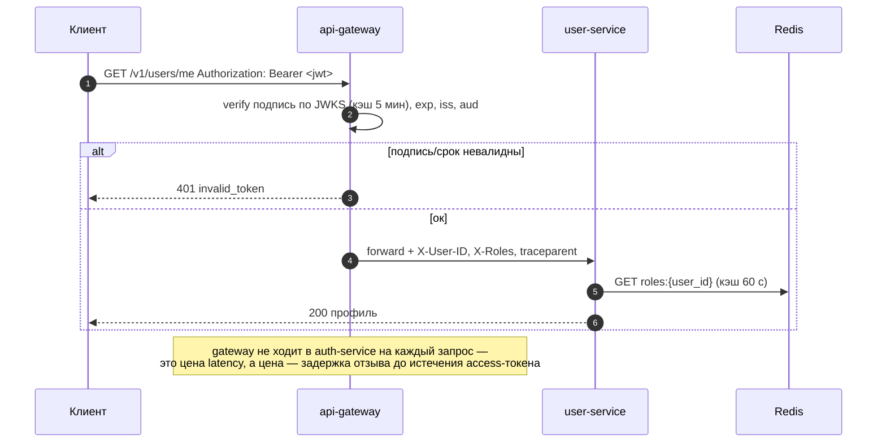
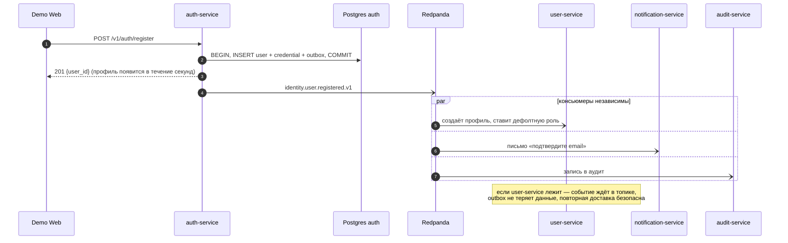
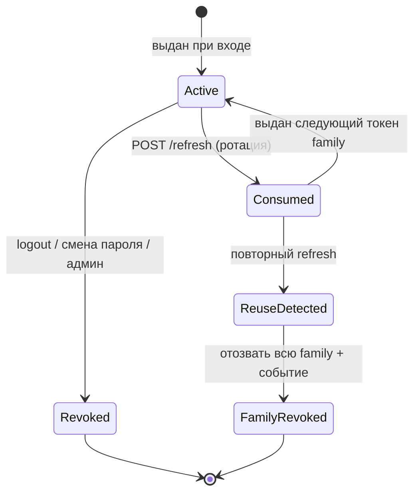
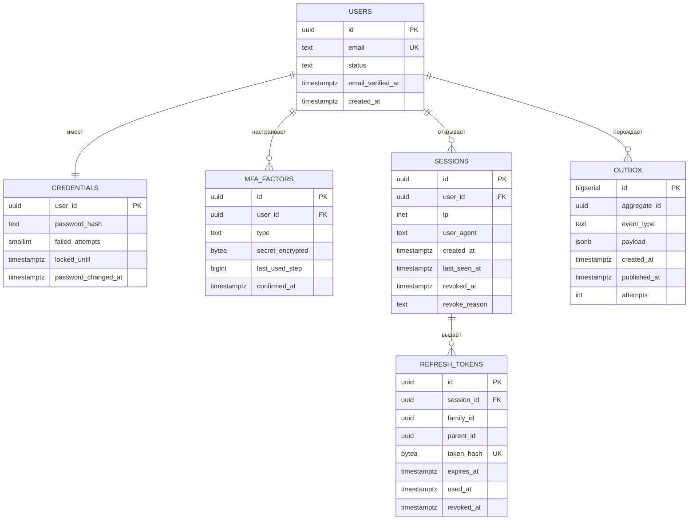
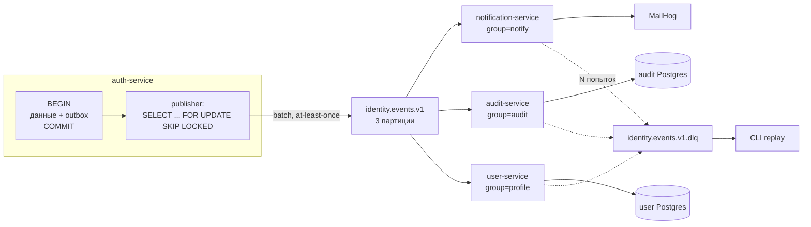

# Auth

# AuthLab — полигон по аутентификации и микросервисам
Учебный проект: несколько небольших сервисов, которые вместе дают полноценный
identity-слой — регистрацию, вход, MFA, сессии, JWT, OIDC-провайдер — плюс
событийная шина, Redis, отдельные базы и нормальная наблюдаемость.
Главная идея: **аутентификация здесь не «одна ручка /login», а распределённая
система**, где есть доверие между сервисами, отзыв токенов, гонки, повторные
доставки событий и деградация при падении зависимостей. Именно на этих стыках и
происходит основное обучение.
> Статус: этап проектирования. Кода ещё нет — это ТЗ и архитектура.
---
## 1. Чему учим проект
| Технология | Что реально осваиваем |
|---|---|
| **JWT / OIDC / OAuth2** | подпись EdDSA, `kid` и ротация ключей, JWKS, claims, `aud`/`iss`, authorization code + PKCE |
| **Refresh-токены** | ротация, family, детект повторного использования, отзыв сессий |
| **MFA** | TOTP (RFC 6238), окно ±1 шаг, replay-guard, recovery-коды |
| **Postgres** | схема на сервис, транзакции, транзакционный outbox, индексы под запросы |
| **Redis** | сессии, rate limit (sliding window), кэш ролей, jti-денлист, single-use челленджи |
| **Redpanda (Kafka API)** | топики/партиции/ключи, consumer groups, at-least-once, идемпотентные консьюмеры, DLQ |
| **Микросервисы** | границы ответственности, синхронные вызовы vs события, таймауты, retry, деградация |
| **Observability** | OTel-трейсы через HTTP и Kafka, метрики RED/USE, структурированные логи, алерты |
| **Надёжность** | хаос-эксперименты: убить Redis / Redpanda / user-service и посмотреть, что сломается |
**Чего в проекте нет (сознательно):** Kubernetes, service mesh, Vault, multi-region,
биллинг, сложный фронтенд. Это следующие ступени, не первая.
---
## 2. Акторы и сценарии
**Акторы:** гость, пользователь, администратор, внешний OIDC-клиент (demo SPA),
внутренние сервисы (доверенная зона).
**Пользовательские сценарии (MVP):**
1. Регистрация по email + паролю → письмо с подтверждением → подтверждение.
2. Вход по паролю; при включённом MFA — второй шаг с TOTP.
3. Просмотр активных сессий и устройств, отзыв одной сессии или всех сразу.
4. Обновление access-токена по refresh-cookie (незаметно для пользователя).
5. Восстановление пароля по email; после смены пароля все сессии отзываются.
6. Включение/отключение TOTP, генерация recovery-кодов.
7. Админ: список пользователей, выдача ролей, принудительный отзыв сессий,
   просмотр аудита.
**Сценарий «внешний клиент» (этап 4):** demo SPA ходит в `/oauth2/authorize`
как обычный OIDC-клиент, получает код, меняет на токены по PKCE, читает `/userinfo`.
---
## 3. Архитектура (C4, уровень контейнеров)

### Принципы
- **Gateway тонкий.** Маршрутизация, `X-Request-ID`, edge rate limit, проверка
  подписи JWT по JWKS-кэшу (быстрый отказ до бизнес-логики). Никаких решений о
  правах — только транспорт и грубая защита.
- **Один сервис — одна причина меняться.** `auth-service` знает про пароли и
  токены и не знает про аватарки; `user-service` знает про профиль и роли и не
  знает про пароли.
- **Синхронно — только когда ответ нужен прямо сейчас** (проверить пароль,
  получить роли при выпуске токена). Всё остальное — события.
- **Никаких общих таблиц между сервисами.** Только API и события. Это главное
  правило, которое и делает из «одного приложения» микросервисы.
---
## 4. Сервисы и границы ответственности
| Сервис | Отвечает за | Не отвечает за |
|---|---|---|
| `api-gateway` | входная точка, TLS-терминация (в dev — нет), маршруты, лимиты, проброс identity-заголовков | бизнес-логику, хранение пользователей |
| `auth-service` | личности и учётные данные, пароли, MFA, сессии, refresh-токены, подпись JWT, OIDC-эндпоинты, ключи | профиль, роли, отправку писем |
| `user-service` | профиль, роли/права (RBAC), админ-операции, источник истины для claims о ролях | пароли, токены |
| `notification-service` | шаблоны писем, отправка через SMTP, ретраи | знание о том, кто такой пользователь |
| `audit-service` | неизменяемый журнал событий безопасности, поиск по нему, простые аномалии | принятие решений о доступе |
| Demo Web App | UI, OIDC-клиент, хранение access-токена **в памяти** | хранение refresh-токена в JS |
**Почему сессии в `auth-service`, а не отдельным сервисом.** Для обучения
достаточно четырёх сервисов; отдельный session-service добавил бы распределённую
транзакцию на ровном месте. Если захочется — вынос сессий в отдельный сервис
описан в разделе «Что дальше» как упражнение.
---
## 5. Ключевые потоки
### 5.1 Вход с MFA и выпуск токенов

### 5.2 Обновление токена и детект повторного использования

Смысл ротации: украденный refresh-токен можно использовать один раз, после чего
легитимный клиент придёт со «старым» токеном, и мы увидим reuse → отзовём всю
family. Это и есть главное упражнение по безопасности сессий.
### 5.3 Запрос к защищённому ресурсу

### 5.4 Регистрация как хореография (события вместо оркестратора)

Здесь сознательно нет саги с компенсациями: регистрация не требует
распределённой транзакции, потому что шаги идемпотентны и допустимо
согласованное во времени состояние. Это важный вывод, а не упрощение.
### 5.5 Жизненный цикл refresh-токена

---
## 6. Модель данных
### 6.1 Postgres `auth` (основное)

Остальные таблицы: `signing_keys` (активные/ротация), `mfa_recovery_codes`,
`email_verifications`, `password_resets` (все токены — только хэши).
**Postgres `user`:** `profiles`, `roles`, `permissions`, `role_permissions`,
`user_roles`, `outbox`.
**Postgres `audit`:** `audit_events` (append-only, индексы по `actor_id`,
`occurred_at`, `event_type`), `processed_events` (идемпотентность).
### 6.2 Redis: что и зачем
| Ключ | TTL | Назначение |
|---|---|---|
| `rl:{scope}:{id}:{window}` | 1–60 с | rate limit, атомарный `INCR` + `EXPIRE` или Lua-окно |
| `sess:{sid}` | = жизни сессии | быстрая проверка «сессия жива» без похода в Postgres |
| `rt:{family_id}` | 30 дней | текущий refresh-токен family, чтобы ловить reuse |
| `jti:deny:{jti}` | ≤ жизни access-токена | мгновенный отзыв конкретного access-токена |
| `roles:{user_id}` | 60 с | кэш ролей для выпуска claims |
| `mfa:challenge:{id}` | 5 мин | состояние второго шага, single-use |
| `totp:step:{user_id}` | 90 с | защита от повторного использования кода |
| `jwks:{kid}` | 5 мин | кэш публичных ключей в gateway |
Правило: **в Redis нет единственного источника истины**. Всё, что нельзя
потерять, лежит в Postgres; Redis можно потерять и пережить (с деградацией).
---
## 7. События
### 7.1 Каталог топиков
| Топик | Продюсер | Консьюмеры | Ключ |
|---|---|---|---|
| `identity.events.v1` | auth-service | audit, notification, user | `aggregate_id` (user_id) |
| `user.events.v1` | user-service | audit | `aggregate_id` |
| `identity.events.v1.dlq` | консьюмеры | ручной replay | — |
Типы событий: `identity.user.registered.v1`, `identity.user.email_verified.v1`,
`identity.session.created.v1`, `identity.session.revoked.v1`,
`identity.mfa.enabled.v1`, `identity.password.changed.v1`,
`identity.login.failed.v1` (сэмплирование), `user.role.assigned.v1`,
`user.profile.updated.v1`.
### 7.2 Конверт события
```json
{
  "event_id": "0f3c1e9a-5b1d-4a7e-9c2f-1d2b3c4d5e6f",
  "event_type": "identity.session.revoked.v1",
  "occurred_at": "2026-11-17T13:37:00Z",
  "producer": "auth-service",
  "aggregate_id": "9b2f...",
  "trace_id": "4bf92f3577b34da6a3ce929d0e0e4736",
  "schema_version": 1,
  "payload": {
    "user_id": "9b2f...",
    "session_id": "3ad1...",
    "reason": "reuse_detected"
  }
}
```
### 7.3 Гарантии и правила

- **Transactional outbox** вместо «записать в БД, потом отправить в Kafka»: иначе
  при падении между шагами событие теряется навсегда.
- **At-least-once**, значит консьюмер обязан быть идемпотентным:
  `INSERT INTO processed_events(event_id) ON CONFLICT DO NOTHING` в той же
  транзакции, что и бизнес-эффект.
- **Ретраи** с экспоненциальной задержкой и jitter; после N попыток — DLQ.
- **Порядок гарантирован только внутри партиции** — ключ по `aggregate_id`,
  поэтому события одного пользователя не переставляются.
- **Схемы** валидируются на входе и выходе (JSON Schema или Avro + registry —
  второе как растянутая опция).
---
## 8. Безопасность
### 8.1 Токены
| Токен | Формат | Время жизни | Где хранится у клиента |
|---|---|---|---|
| Access | JWT, EdDSA (Ed25519), `kid` в заголовке | 10 мин | память SPA, заголовок `Authorization` |
| Refresh | opaque, 256 бит CSPRNG | 30 дней, ротация | HttpOnly + Secure + SameSite cookie |
| MFA challenge | opaque | 5 мин, single-use | тело ответа, затем заголовок |
| Email verify / reset | opaque, хэш в БД | 24 ч / 15 мин, single-use | ссылка в письме |
Claims access-токена: `iss`, `sub`, `aud`, `exp`, `iat`, `jti`, `sid`, `roles[]`,
`scope`, `amr[]` (какие факторы пройдены), `auth_time`.
Ключи подписи: приватный ключ только в `auth-service` (в проде — KMS/Vault), в
БД лежит зашифрованным; публичная часть отдаётся в `/jwks.json`; ротация раз в
30 дней с перекрытием, старый `kid` живёт до истечения выданных им токенов.
### 8.2 Модель угроз (учебный минимум)
| Угроза | Мера | Где |
|---|---|---|
| Перебор паролей / credential stuffing | rate limit по IP и по email, прогрессивная задержка, lockout с backoff | gateway + auth |
| User enumeration | одинаковый ответ и тайминг на «нет пользователя» и «неверный пароль» | auth |
| Кража refresh-токена | ротация + reuse detection + отзыв family | auth |
| XSS-кража токена | access только в памяти, refresh в HttpOnly | web + auth |
| CSRF на refresh | SameSite=Lax + отдельный CSRF-токен для state-changing запросов | auth/gateway |
| Replay TOTP | хранение последнего использованного шага | auth |
| Подделка JWT | подпись + `aud`/`iss` + короткий TTL + `kid` | gateway |
| Устаревшие роли в токене | TTL 10 мин + `jti`-денлист для критичных действий | auth |
| Privilege escalation | проверка роли на стороне user-service, а не только в gateway | user |
| Утечка PII в логи/трейсы | запрет на email/токены/пароли в атрибутах, редактирование | все |
| Слабые секреты в репозитории | только `.env.example`, секреты через env, проверка в CI | infra |
### 8.3 Что именно нужно не забыть
- Argon2id: `m=64MB, t=3, p=2`, соль на пользователя, «фиктивный» хэш для
  несуществующих пользователей (constant-time).
- Все токены в БД — только `sha256`, сравнение через `subtle.ConstantTimeCompare`
  или поиск по индексу хэша.
- TOTP-секрет шифруется (AES-GCM) ключом из окружения, не лежит открытым.
- Recovery-коды: 10 штук, одноразовые, хранятся хэшами.
- Смена пароля → отзыв всех сессий, кроме текущей; сброс пароля → отзыв всех.
- Никакой самописной криптографии. Только `crypto/*`, `golang.org/x/crypto`,
  проверенные библиотеки JWT.
---
## 9. Наблюдаемость
### 9.1 Три сигнала
- **Трейсы:** W3C `traceparent` от gateway до сервисов и дальше в Kafka-заголовки;
  спаны на HTTP, SQL, Redis, publish/consume. Атрибуты — `user_id` (хэш), но не
  email и не токены.
- **Метрики (RED + бизнес):**
  `http_requests_total{route,status}`, `http_request_duration_seconds`,
  `auth_login_attempts_total{result}`, `auth_refresh_reuse_detected_total`,
  `auth_mfa_verify_total{result}`, `rate_limit_hits_total{scope}`,
  `db_pool_in_use`, `redis_op_duration_seconds`,
  `outbox_unpublished_total`, `kafka_consumer_lag{group,topic}`,
  `dlq_messages_total`.
- **Логи:** JSON, обязательные поля `ts, level, service, trace_id, span_id,
  request_id, msg`; ошибки — с `error.code`, без стэков с данными пользователя.
### 9.2 Дашборды и алерты
Дашборды: «Auth overview» (RPS, ошибки, p95 по маршрутам), «Login funnel»
(попытки → успех → MFA → сессия), «Sessions & tokens» (активные сессии,
reuse-детекты), «Event pipeline» (лаг консьюмеров, outbox, DLQ), «Dependencies»
(Postgres, Redis, Redpanda).
Алерты (учебные, но по-настоящему полезные):
| Алерт | Условие |
|---|---|
| Всплеск отказов входа | `auth_login_attempts_total{result="bad_password"}` > 50/мин 5 минут |
| Brute force по аккаунту | > 10 неудач на один email за 15 мин |
| Refresh reuse | любой `refresh_reuse_detected` > 0 |
| Outbox застрял | `outbox_unpublished_total` > 100 или старше 5 мин |
| Консьюмер отстал | `kafka_consumer_lag` > 1000 5 минут |
| DLQ не пуста | `dlq_messages_total` > 0 |
| Redis недоступен | `up{job="redis"} == 0` 1 минуту |
### 9.3 SLO для упражнения
- p95 `POST /v1/auth/login` ≤ 300 мс (Argon2id — основная стоимость).
- p95 `POST /v1/auth/refresh` ≤ 80 мс.
- p95 защищённого запроса ≤ 50 мс при живом JWKS-кэше.
- Событие «зарегистрирован» → письмо отправлено ≤ 5 с (p95).
- Потерянных событий: 0 (проверяется сверкой outbox и `processed_events`).
---
## 10. Технологический стек
| Слой | Выбор | Почему |
|---|---|---|
| Язык | Go 1.23+ | быстрый старт, отличный stdlib для HTTP/crypto, статические бинарники |
| HTTP | `chi` (gateway, auth, user), stdlib `net/http` | минимум магии, видно, как всё устроено |
| gRPC | `connect-go` или `grpc-go` для auth → user | один честный пример синхронного RPC |
| БД | PostgreSQL 16 | транзакции, `jsonb`, `citext`, оконные функции |
| Доступ к БД | `pgx/v5` + `sqlc` | типизированные запросы без ORM-магии |
| Миграции | `golang-migrate` | обычные SQL-файлы |
| Кэш/лимиты | Redis 7 | TTL, Lua-скрипты, `GETDEL` |
| Шина | Redpanda | Kafka API без ZooKeeper/JVM, удобно локально |
| Kafka-клиент | `franz-go` | производительный, понятный API |
| Трейсы/метрики/логи | OpenTelemetry SDK → OTLP | единый стандарт, не привязан к вендору |
| Стек наблюдаемости | Grafana + Prometheus + Tempo + Loki (+ Alloy) | всё локально в compose |
| Почта | MailHog | SMTP без реальных писем |
| Фронт | React + Vite + TypeScript | демо-клиент и OIDC-площадка |
| Тесты | `testing`, `testcontainers-go`, Playwright, k6 | юнит + интеграция + e2e + нагрузка |
| Запуск | Docker Compose | одна команда `make up` |
**Если Go не хочется.** Архитектура не меняется, меняется только реализация:
| Роль | Go | Kotlin | TypeScript | Python |
|---|---|---|---|---|
| HTTP | chi | Ktor/Spring Boot | NestJS/Fastify | FastAPI |
| БД | pgx + sqlc | Exposed/jOOQ | Drizzle/Prisma | SQLAlchemy |
| Kafka | franz-go | kafka-clients | KafkaJS | aiokafka |
| OTel | otel-go | otel-java | otel-js | otel-python |
---
## 11. API (набросок)
### auth-service
| Метод | Путь | Назначение |
|---|---|---|
| POST | `/v1/auth/register` | регистрация |
| POST | `/v1/auth/login` | вход, возможно `202` + `mfa_token` |
| POST | `/v1/auth/mfa/verify` | второй фактор |
| POST | `/v1/auth/refresh` | ротация refresh |
| POST | `/v1/auth/logout` | отзыв текущей сессии |
| POST | `/v1/auth/logout-all` | отзыв всех сессий |
| GET | `/v1/auth/sessions` | список активных сессий |
| DELETE | `/v1/auth/sessions/{id}` | отзыв конкретной сессии |
| POST | `/v1/auth/password/forgot` | запрос сброса |
| POST | `/v1/auth/password/reset` | сброс по токену |
| POST | `/v1/auth/email/verify` | подтверждение email |
| POST | `/v1/auth/mfa/totp/enroll` | выдача секрета + QR |
| POST | `/v1/auth/mfa/totp/confirm` | подтверждение, включение |
| DELETE | `/v1/auth/mfa/totp` | отключение (требует пароль) |
| GET | `/.well-known/openid-configuration` | discovery |
| GET | `/.well-known/jwks.json` | публичные ключи |
| GET/POST | `/oauth2/authorize` | code + PKCE |
| POST | `/oauth2/token` | обмен кода / refresh |
| GET | `/oauth2/userinfo` | claims пользователя |
### user-service
| Метод | Путь | Назначение |
|---|---|---|
| GET | `/v1/users/me` | свой профиль |
| PATCH | `/v1/users/me` | правка профиля |
| GET | `/v1/users/{id}` | админ: карточка |
| GET | `/v1/users?query=&limit=` | админ: поиск |
| GET | `/v1/roles` | список ролей |
| POST | `/v1/users/{id}/roles` | выдать роль |
| DELETE | `/v1/users/{id}/roles/{role}` | снять роль |
| GET | `/internal/users/{id}/roles` | внутренний, для auth (gRPC в идеале) |
### Прочее
`GET /healthz`, `GET /readyz`, `GET /metrics` — у каждого сервиса.
`GET /v1/audit/events?actor_id=&from=&to=` — audit-service.
Ошибки — единый формат: `{"error":{"code":"invalid_credentials","message":"...","request_id":"..."}}`.
Коды: `invalid_credentials`, `mfa_required`, `invalid_token`, `rate_limited`,
`account_locked`, `email_not_verified`, `conflict`, `internal`.
---
## 12. Запуск и структура репозитория
```text
auth-service/
├── cmd/
│   ├── gateway/  auth/  user/  notification/  audit/
├── internal/
│   ├── auth/          # домен: пароли, сессии, токены, mfa
│   ├── user/
│   ├── notify/
│   ├── audit/
│   ├── platform/      # config, logger, otel, httpserver, redis, pgx, kafka
│   └── contract/      # события, DTO, общие ошибки
├── migrations/{auth,user,audit}/
├── api/               # openapi.yaml, proto/
├── deploy/
│   ├── compose.yaml
│   └── grafana/  prometheus/  otel/
├── web/               # demo SPA
├── tests/             # e2e, load
├── Makefile
└── README.md
```
Порты: gateway `8000`, auth `8001`, user `8002`, notification `8003`, audit
`8004`, web `5173`, Postgres `5432`, Redis `6379`, Redpanda `9092` (admin
`9644`), Redpanda Console `8085`, Grafana `3000`, Prometheus `9090`, Tempo
`3200`, Loki `3100`, MailHog UI `8025`.
Команды: `make up` (compose), `make migrate`, `make seed`, `make test`,
`make load`, `make down`. Конфиг — через env, `.env.example` в репозитории.
---
## 13. Этапы
| Этап | Содержание | Результат (Definition of Done) | Оценка |
|---|---|---|---|
| **M0. Каркас** | репозиторий, compose, platform-слой, healthz, OTel, CI-линт | `make up` поднимает инфру, сервисы отвечают на `/healthz`, трейс виден в Tempo | 2–3 вечера |
| **M1. Ядро identity** | register/login/logout, Argon2id, JWT + JWKS, refresh-ротация, список сессий | e2e: регистрация → вход → refresh → logout; reuse ловится тестом | 4–6 вечеров |
| **M2. События** | outbox, Redpanda, notification + audit консьюмеры, идемпотентность, DLQ | письмо приходит после регистрации; дубль события не создаёт дубль письма; DLQ работает | 3–4 вечера |
| **M3. Защита** | rate limit, lockout, TOTP + recovery, verify email, reset, RBAC + админка | сценарии из раздела 2 проходят; алерты на brute force и reuse срабатывают | 5–7 вечеров |
| **M4. OIDC** | discovery, authorize + PKCE, token, userinfo, demo SPA как RP | SPA логинится через стандартный OIDC-флоу без знания внутренностей auth | 4–5 вечеров |
| **M5. Надёжность** | дашборды, алерты, k6, хаос-тесты | раздел 14 пройден, есть отчёт «что упало и почему» | 3–4 вечера |
| **M6. Опционально** | passkeys/WebAuthn, соц-логин, multi-tenancy, k8s, Vault | по желанию | — |
Итого до M5 — примерно 20–30 вечеров. Если времени мало, минимальный полезный
срез: **M0 + M1 + M2** (уже даёт и auth, и микросервисы, и события).
---
## 14. Тестирование и хаос
**Уровни:**
- Unit: хэширование/проверка пароля, TOTP, ротация и reuse, парсинг/валидация
  claims, idempotency-хэндлер.
- Integration (`testcontainers`): Postgres + Redis + Redpanda, реальные
  миграции, реальный outbox-publisher.
- Contract: OpenAPI-схема как источник истины, проверка ответов в тестах.
- E2E (Playwright + compose): полный путь пользователя, включая письмо в MailHog.
- Load (k6): 50 rps login, 200 rps refresh, 500 rps защищённых запросов.
- Security-чеклист: OWASP ASVS L1 вручную + `gosec`, `govulncheck`, `trivy`.
**Хаос-эксперименты (по одному, с наблюдением в Grafana):**
| Ломаем | Ожидаемое поведение |
|---|---|
| Redis недоступен | вход работает, rate limit деградирует (fail-open + метрика), сессии читаются из Postgres |
| Redpanda недоступен | API не падает, outbox растёт, алерт, после восстановления — догоняет |
| user-service недоступен | вход по кэшу ролей; регистрация отвечает 201, профиль создаётся позже |
| консьюмер падает на середине | повторная доставка не дублирует эффект, сообщение уходит в DLQ после N попыток |
| часы уехали на 10 минут | TOTP не проходит, JWT отвергается — проверяем, что это не «тихая» ошибка |
---
## 15. Риски и компромиссы
| Риск | Решение |
|---|---|
| Слишком много сервисов сразу | старт с 2 (gateway + auth), остальные добавляются на M2–M3 |
| «Микросервисы ради микросервисов» | каждый сервис появляется под конкретную задачу из раздела 2 |
| Сложно отлаживать асинхронность | OTel-трейсы через Kafka + `processed_events` + DLQ-viewer с первого дня M2 |
| Соблазн самописной криптографии | только stdlib и проверенные библиотеки, ревью этого пункта в чеклисте |
| Расхождение ролей в токене и в БД | короткий TTL + `jti`-денлист для критичных операций + событие `role.assigned` |
| Утечка секретов | `.env.example`, `git-secrets`/gitleaks в pre-commit, ключи только через env |
**Осознанные компромиссы:** один инстанс Postgres с тремя базами (в проде —
отдельные инстансы); нет mTLS между сервисами (доверенная сеть compose); нет
мультирегиона и шардирования; сессии не вынесены в отдельный сервис.
---
## 16. Открытые вопросы (решить до M1)
1. Роли хранятся только в `user-service` или ещё дублируются в claims? Сейчас:
   источник истины — `user-service`, в токене — снимок на 10 минут.
2. Нужен ли `jti`-денлист в MVP? Он даёт мгновенный отзыв, но добавляет поход в
   Redis на каждый запрос. Предложение: включить только для админ-эндпоинтов.
3. OIDC-клиенты хранить в БД или в конфиге? Для M4 достаточно конфига, в M6 —
   таблица `clients` с `client_secret_hash` и `redirect_uris`.
4. Письма — MailHog или сразу реальный SMTP-провайдер? MailHog, иначе тесты
   станут платными и медленными.
5. Один репозиторий (monorepo) или несколько? Monorepo: проще менять контракты,
   общий `platform/` и compose.
---
## 17. Что дальше (после базового сценария)
- **Passkeys / WebAuthn** — самый интересный современный фактор; добавляется как
  ещё один `mfa_factor` без изменения модели сессий.
- **Соц-логин** (OIDC federation) — auth-service становится и RP, и OP.
- **Multi-tenancy** — `tenant_id` в токене, изоляция ролей и ключей.
- **Kubernetes + Helm** — health-пробы, HPA, secret-хранилище.
- **Vault/KMS** — вынос приватных ключей и TOTP-секретов.
- **SCIM** — синхронизация пользователей с внешним IdP.
- **Аномалии** — аудит уже собирает данные; можно добавить простую модель
  «новое устройство/страна» на событиях.
---
## 18. Итог одной фразой
Строим **учебный identity-провайдер**: `gateway` + `auth` + `user` +
`notification` + `audit`, с Postgres на сервис, Redis для горячих состояний,
Redpanda для событий через outbox, OTel-наблюдаемостью и настоящей проработкой
токенов, сессий и MFA — чтобы на практике понять, где у распределённой
аутентификации болят места.
